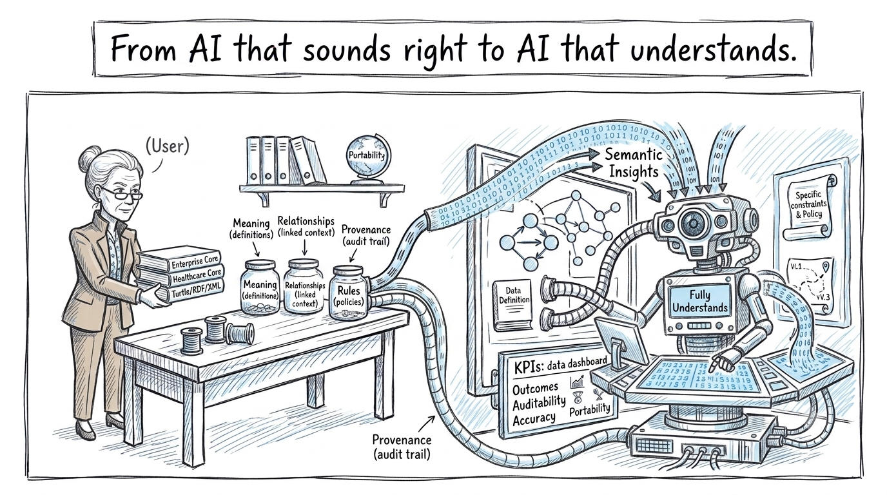
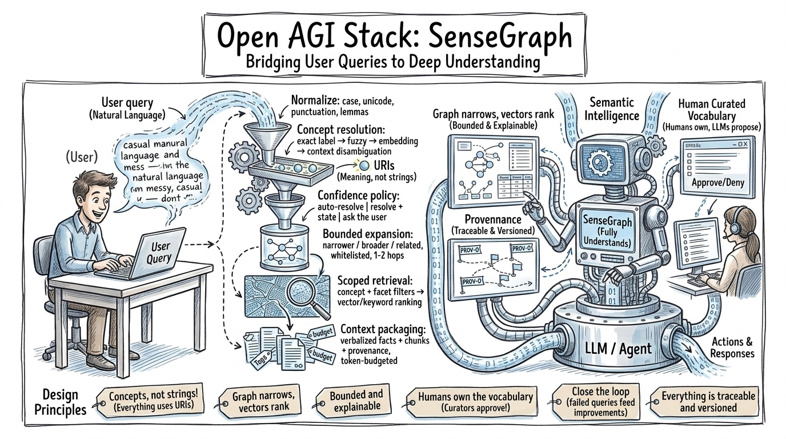
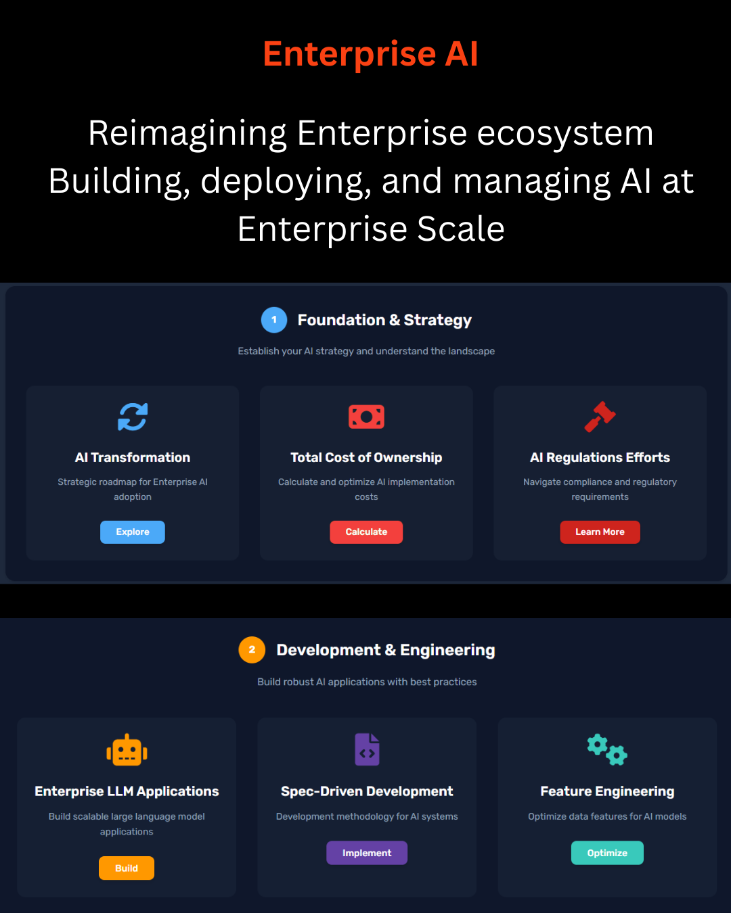
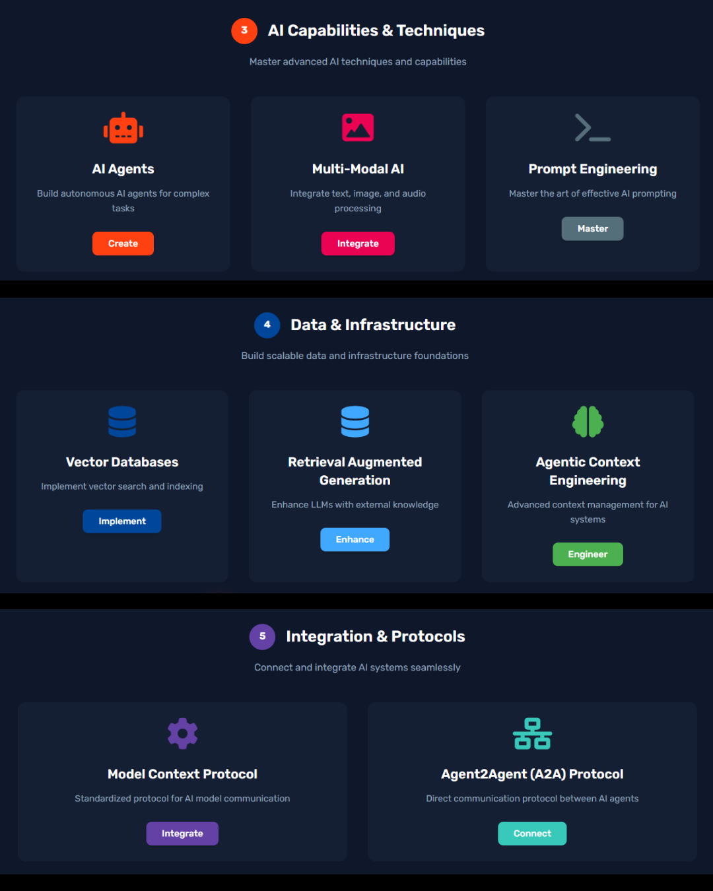
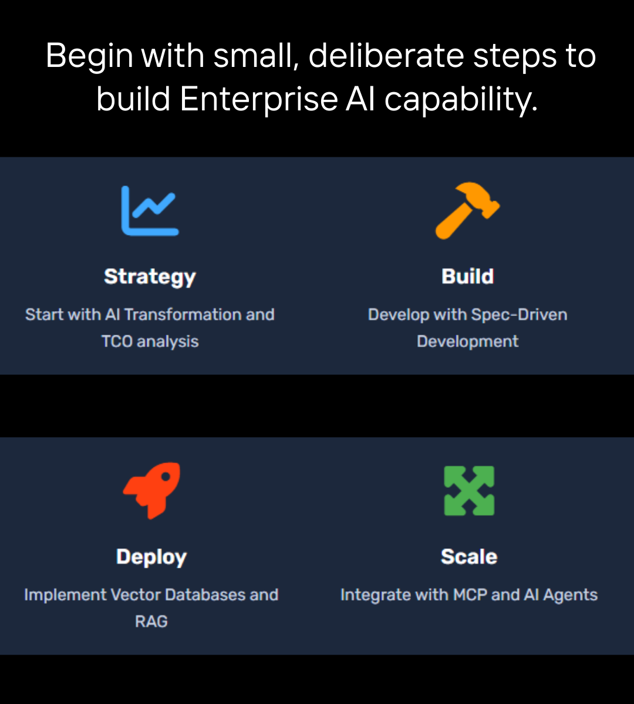

<!--
**amitpuri/amitpuri** is a ✨ _special_ ✨ repository because its `README.md` (this file) appears on your GitHub profile.
[](https://twitter.com/iamamitpuri)

Here are some ideas to get you started:
-->

In 2026, may your creativity scale like parameters in a neural net, your insights converge like reasoning paths, and your actions embody the initiative of agentic intelligence.

I'm a tech enthusiast who is passionate about encouraging others to write clean and better code, though AI assisted to make difference. 

I am a seasoned technologist with over two decades of experience in driving digital transformation across multiple domains. 

My expertise spans cloud adoption, AI integration, and strategic technology consulting, where I’ve led large-scale projects and provided innovative solutions to global clients. 

I’m passionate about enabling teams to leverage emerging technologies and driving business growth through effective digital strategies.

<div align="center">

# Open AGI Stack

### Intelligence into the products

**The Semantic Intelligence layer for enterprise AI**

*From AI that sounds right to AI that understands.*
*Give your AI the context your people already carry.*


### Start with ready-made ontology starter packs, such as Enterprise Core and Industry related packs like Healthcare Core, written in Turtle or RDF/XML. Then shape them into a semantic intelligence that is fully yours.

------------------------------------------------------------------------------------------------------------------------------------
  [](https://www.openagistack.com/articles/open-agi-stack-semantic-article/)
  Read [https://www.openagistack.com/articles/open-agi-stack-semantic-article/](https://www.openagistack.com/articles/open-agi-stack-semantic-article/)


</div>

## Semantics

Enterprise AI stalls on **meaning**, not model quality. **Open AGI Stack Semantics** turns human-written policies, glossaries, and schemas into executable semantic intelligence that AI agents can **verify, cite, and run**.

### The Four-Plane Operating Architecture for Enterprise AI

[](https://www.openagistack.com/images/products/semantic-intelligence-semantics.png)

---

## The Four-Plane Architecture

| Plane | Character | Role |
|-------|-----------|------|
| **Meaning Plane** | Slow, Governed | Authoritative repository of business meaning |
| **Facts Plane** | Fast, Validated | High-throughput, gate-checked operational data |
| **Policy Plane** | Security & Audit | Access control, regulatory boundaries, immutable logging |
| **Agent Plane** | Grounding & Execution | Runtime interface where agents converse and act |

```text
┌──────────────────────────────────────────────────────────────┐
│  AGENT PLANE      Grounding & Execution                      │
│  resolve concepts · broker context · validate plans          │
├──────────────────────────────────────────────────────────────┤
│  POLICY PLANE     Security & Audit                           │
│  RBAC / ABAC · semantic labels · action log · PROV-O         │
├──────────────────────────────────────────────────────────────┤
│  FACTS PLANE      Fast, Validated                            │
│  map & ingest · ABox store · SHACL gates · audit stamps      │
├──────────────────────────────────────────────────────────────┤
│  MEANING PLANE    Slow, Governed                             │
│  author · validate · evaluate · version · pin                │
└──────────────────────────────────────────────────────────────┘
        ▲                                                │
        └──────── Continuous Feedback Backlog ◄──────────┘
        (failures and unmapped queries return as draft change sets)
```

---

## Meaning Plane
**Slow, Governed**

The authoritative repository of business meaning. Curated by domain archivists and stewards, where concepts are authored, validated, evaluated, and versioned before pinning.

**Key Services**

- Official Archivist & Stewardship
- Authoring & Change Service
- Registry & Release Service
- Reasoning (TBox) & Validation
- Evaluation & Consistency Service

---

## Facts Plane
**Fast, Validated**

High-throughput operational ingestion pipeline. Raw enterprise data is mapped into instances (ABox), materialized, and gate-checked with SHACL schemas before receiving audit stamps.

**Key Services**

- Mapping & Ingestion Service
- ABox Instance Store (Asserted & Inferred)
- Quarantine & Provenance Isolation
- Materializer Engine
- SHACL Validator & Audit Stamping

---

## Policy Plane
**Security & Audit**

Fine-grained security, regulatory boundaries, and immutable execution logging. Ensures agents only touch authorized slices of data and generates tamper-proof PROV-O audit receipts.

**Key Services**

- Policy & Access Service (RBAC / ABAC)
- Semantic Labels & Security Bundles
- Action Layer & Real-time Action Log
- Audit & PROV-O Receipt Service

---

## Agent Plane
**Grounding & Execution**

The runtime interface where enterprise AI agents converse and execute. Brokers context, resolves concepts, validates plans, and closes the loop by feeding failures back into draft change sets.

**Key Services**

- Resolution Service (Lexical + Vector)
- Context Broker & Token Budgeter
- Grounding (Evidence & Plan Checks)
- API Gateway, SPARQL & MCP Endpoints
- Continuous Feedback Backlog

---

## Semantics Design Principles

### Slow, Governed Meaning
Humans define and approve vocabulary once; machines never guess semantic truth.

### Fast, Validated Facts
Real-time data ingestion enforced by deterministic SHACL constraints and validation gates.

### Security & Audit
Every read, write, and inference is bounded by policy and leaves an immutable PROV-O receipt.

### Continuous Feedback
Execution failures and unmapped queries feed back to curators as draft change proposals.

### Traceable & Versioned
Every concept, rule, and fact pin is versioned. Models can change, but meaning never drifts.

---


---

## SenseGraph

Natural human language is messy, casual, and ambiguous. **SenseGraph** translates unstructured user queries into grounded, deterministic **knowledge graphs** and **scoped vector retrieval**, so agents can act on meaning rather than surface text.

Start with ready-made **ontology starter packs** such as **Enterprise Core** and Industry related packs like **Healthcare Core**, written in **Turtle** or **RDF/XML**. Then shape them into a semantic intelligence that is fully grounded in your organization's approved vocabulary.

[](https://www.openagistack.com/images/products/semantic-intelligence-sensegraph.png)

---

## Bridging User Queries to Deep Understanding

Most AI systems match text to text. SenseGraph matches **meaning** to **meaning**:

Raw user input is resolved into unambiguous concepts with persistent URIs.

The ontology graph defines strict, deterministic boundaries for what is relevant.

Vector and keyword engines rank results only inside those boundaries.

Every fact that reaches the model carries provenance, a timestamp, and the active ontology version.

The result is an agent that knows what the user meant, can explain how it got there, and stays inside the vocabulary your domain experts have approved.

---

## Ontology Starter Packs

| Pack | Purpose | Formats |
|------|---------|---------|
| **Enterprise Core** | Foundational concepts shared across organizations | Turtle (`.ttl`), RDF/XML (`.rdf`) |
| **Healthcare Core** | Domain vocabulary for healthcare use cases | Turtle (`.ttl`), RDF/XML (`.rdf`) |

Starter packs are a foundation, not a ceiling. Extend them with your own concepts, synonyms, and relationships until the ontology reflects how your organization actually speaks.

---

## The SenseGraph Engine: From Query to Grounded Action

### 6-Stage Query Understanding Pipeline

| Stage | Name | What it does |
|:-----:|------|--------------|
| **1** | **Normalize** *(String Ingestion)* | Cleans case, applies Unicode normalization, fixes punctuation anomalies, and reduces words to linguistic lemmas from raw human input. |
| **2** | **Concept Resolution** *(Concepts, Not Strings)* | Matches exact labels, synonyms, fuzzy variants, and vector embeddings to resolve inputs into unambiguous, persistent URIs. |
| **3** | **Confidence Policy** *(Tri-State Guardrails)* | Evaluates certainty. High-confidence concepts auto-resolve, medium-confidence concepts come with a stated assumption, and low-confidence concepts are disambiguated by asking the user. |
| **4** | **Bounded Expansion** *(Constrained Traversal)* | Traverses ontology relationships (`narrower`, `broader`, `related`) along whitelisted paths, strictly capped at 1 to 2 hops. |
| **5** | **Scoped Retrieval** *(Graph Narrows, Vectors Rank)* | Applies graph concept and facet boundaries to filter the search space before vector and keyword engines rank relevant chunks. |
| **6** | **Context Packaging** *(Token-Budgeted Grounding)* | Compiles verbalized graph facts, verified text chunks, and PROV-O audit trails into token-budgeted prompt envelopes. |

```text
User query
   │
   ▼
[1] Normalize ──► [2] Concept Resolution ──► [3] Confidence Policy
                                                   │
                     ┌─────────────────────────────┼───────────────────────┐
                     ▼                             ▼                       ▼
                auto-resolve                state assumption          ask the user
                     │                             │
                     └──────────────┬──────────────┘
                                    ▼
                          [4] Bounded Expansion (1–2 hops)
                                    ▼
                          [5] Scoped Retrieval (graph filters, vectors rank)
                                    ▼
                          [6] Context Packaging (facts + chunks + PROV-O)
                                    ▼
                             Grounded agent action
```

---

## SenseGraph Design Principles

### Concepts, Not Strings
Everything resolves to persistent URIs. No more ambiguity between "ATM" (the machine) and "ATM" (the mode).

### Graph Narrows, Vectors Rank
Ontology graphs define strict, deterministic boundaries, while vector search ranks the best matches within them.

### Bounded and Explainable
Predictable, shallow-hop traversals with explicit reasoning paths eliminate runaway hallucinations.

### Humans Own the Vocabulary
LLMs suggest synonyms and mappings, but domain curators have final approve/deny control.

### Close the Loop
Failed query resolutions and unmapped phrases automatically queue up to expand future vocabulary.

### Traceable and Versioned
Every fact retrieved carries its provenance receipt, timestamp, and active ontology version.

---

## Why SenseGraph

| Without SenseGraph | With SenseGraph |
|--------------------|-----------------|
| Matches strings and hopes for the best | Resolves concepts to persistent URIs |
| Search space is the whole corpus | Search space is narrowed by the graph first |
| Unbounded, hard-to-audit reasoning | 1 to 2 hop traversals with explicit paths |
| Vocabulary drifts silently | Curators approve every mapping |
| Misses are lost | Misses feed the vocabulary backlog |
| Answers without receipts | Provenance, timestamp, and ontology version on every fact |

---


------------------------------------------------------------------------------------------------------------------------------------
  [](https://bit.ly/topmate-ap)
------------------------------------------------------------------------------------------------------------------------------------
  [](http://go.amitpuri.com/cd)
------------------------------------------------------------------------------------------------------------------------------------

> Focus on improving yourself and not proving yourself.
------------------------------------------------------------------------------------------------------------------------------------

> Check out
 
> [AI News](https://go.openagi.news)
 
> [Cloud](https://open.amitpuri.com/opencloud.codes/)
 
> [Citizen Developer codes](https://open.amitpuri.com/citizendeveloper.codes/)

 Book (available on Kindle)
> [Citizen Development in Microsoft 365 with Power Platform](https://go.openagi.codes/buynow) 


------------------------------------------------------------------------------------------------------------------------------------
[](https://go.openagi.codes)
------------------------------------------------------------------------------------------------------------------------------------
[](https://go.openagi.codes)
------------------------------------------------------------------------------------------------------------------------------------
[](https://go.openagi.codes)
------------------------------------------------------------------------------------------------------------------------------------
[](https://go.amitpuri.com/dev.to)
[](https://go.amitpuri.com/medium)
[](https://go.amitpuri.com/kaggle)
[](https://go.amitpuri.com/hf)
[](https://go.amitpuri.com/linkedin)
[](https://go.amitpuri.com/badges)

---

<div align="center">   

**Open AGI Stack Semantics** · Semantic Intelligence for enterprise AI

</div>
